# cyd-gta6-phone

Firmware and PC tools for a standalone desk replica of the GTA 6 in-game phone, running on an ESP32-2432S028R "Cheap Yellow Display" (CYD). It doesn't talk to the PS5 or the game.

The firmware is a **generic renderer**. Every app, label, image and colour comes from content packs on the SD card, which the tools build from **your own captures** of the phone (PLAN.md). This repository contains no game assets. reference/, content/ and sd/ are gitignored, and the repo must stay private.

```
firmware/    PlatformIO project (LVGL 9.2, LovyanGFX 1.1.16, ArduinoJson 7.2)
  src/hal/       display, touch, SD/LED/light sensor, audio stub
  src/ui/        renderer, navigation, gestures, video, hidden menu (shared with the simulator)
  src/services/  pack loader, clock, timeline, Wi-Fi + upload endpoint
simulator/   headless build of src/ui: `sim --pack <dir> --screen <id> --out <png>`
tools/       Python ingest and verification tools (+ tests/)
schema/      JSON schemas for manifest, screens and timeline
research/    web research facts (text only, with sources)
```

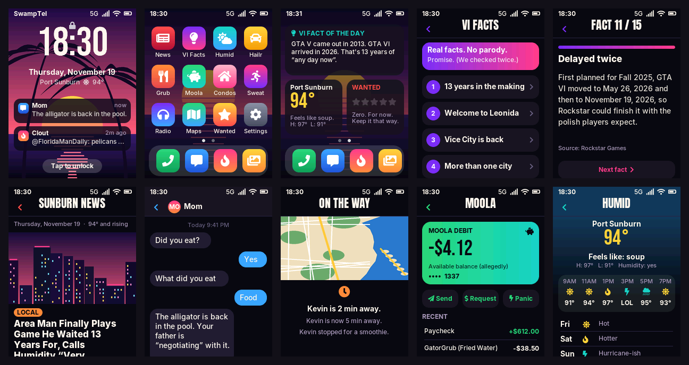

*The GatorPhone VI parody pack (§5b), rendered at the device's 240×320 by the headless simulator, which runs the same UI code as the firmware.*

## 1. Flash the firmware

Two builds exist because the CYD ships with two panels:

| Build | Board |
|---|---|
| `ili9341` | Standard CYD. **The board connected during the build run uses this build, with orientation preset 1** (§2). |
| `st7789` | Some two-USB "CYD2USB" boards |

```bash
cd firmware
uvx --from platformio pio run -e ili9341 -t upload --upload-port /dev/cu.usbserial-XXXX
```

Use a micro-USB cable. The board's USB-C port has no CC resistors, so a C-to-C cable gives it no power. Uploads run at 115200 baud because the CH340 corrupts data at higher speeds behind a hub.

## 2. First boot: hardware test and touch calibration

**Orientation.** CYD panels are not all wired the same way. The firmware has six orientation presets, stored in NVS and switched over USB serial without reflashing: `tools/.venv/bin/python tools/devserial.py cmd "ORIENT n"` (n = 0..5). Each switch clears the touch calibration and restarts. Hold the board upright (tall) and step through them:
- 0/1: the controller is wired landscape. Preset 1 is the setting for the board used in the build run, the second CYD.
- 2/3: standard portrait ILI9341.
- 4/5: mirrored versions of 0 and 1.

`RECAL` clears only the calibration.

1. With no touch calibration stored, the board opens the **hardware test screen**. It shows five colour bars labelled RED, GREEN, BLUE, WHITE and YELLOW, a grey ramp, the SD status and live touch readings.
   - If a bar's colour doesn't match its label, flash the other build. If it is still wrong, use the hidden menu's *Invert colours* or *Swap red/blue* (saved in NVS).
2. Tap anywhere, then tap the five crosses. The calibration is saved in NVS.
3. To repeat later, hold the BOOT button while resetting, or use hidden menu > *Calibrate touch*.

## 3. SD card

FAT32, any size (a 64 GB card works). Layout:

```
/packs/<snapshot-id>/manifest.json, timeline.json, fonts/, apps/<app>/{screens,assets,video,audio}/
/config/wifi.json      optional {"ssid": "...", "password": "..."}; imported into NVS on boot, then blanked
```

Copy the built packs with:

```bash
tools/.venv/bin/python tools/sync.py sd /Volumes/CYDPHONE --delete
```

The device boots into the newest snapshot. Snapshot ids start with the capture date, so the newest session wins.

## 4. Using the device

- Tap and swipe as on the phone. Scroll lists vertically, and swipe home pages horizontally.
- **Back:** swipe right from the left edge. **Home:** swipe up from the bottom edge. These replace controller buttons (DEVIATIONS.md #5).
- **Hidden menu:** hold the status bar (top edge) for 3 s. It offers snapshots, touch calibration, the hardware test, colour fixes, fit mode, Wi-Fi and upload mode.
- The screen sleeps after 2 minutes idle, and a tap wakes it. Brightness follows the room light.

## 5. Capture → ingest → sync (adding a snapshot)

Set up the tools once:

```bash
uv venv --python 3.12 tools/.venv && VIRTUAL_ENV=tools/.venv uv pip install -r tools/requirements.txt
cd firmware && uvx --from platformio pio pkg install && cd ..   # LVGL for the simulator
make -C simulator
```

Then, for each capture session (see CAPTURE_CHECKLIST.md):

| Step | Command |
|---|---|
| 1. Put the captures in place | `reference/<YYYY-MM-DD>_<label>/{notes.md,_system/,<app>/screens,scroll,transitions}` |
| 2. Rectify | `python tools/rectify.py <id>`. Writes content/<id>/canonical/ (960 px wide) and measurements.json (aspect ratio) |
| 3. Stitch scroll videos | `python tools/stitch.py <video> <out.png> --corners-from <still>.corners.json --top <px>` |
| 4. Inventory | `python tools/inventory.py <id>`, then complete the home order and tap map |
| 5. Measure tokens | `python tools/measure.py palette/sample/box/radius/textheight ...` |
| 6. Fonts | `python tools/fonts.py --font <ttf> --sizes 14,17 --out content/<id>/pack/fonts --name body` |
| 7. Transcribe | Write `content/<id>/pack/apps/<app>/screens/*.json` (schema/screen.schema.json), copying text exactly |
| 8. Slice artwork | `python tools/slice.py <canonical.png> x,y,w,h content/<id>/pack/apps/<app>/assets/<name>.bin` |
| 9. Video | `python tools/video.py <clip.mp4> content/<id>/pack/apps/<app>/video/<name>.mjpeg` |
| 10. Clock rate | `python tools/clockrate.py <video_s>=<HH:MM> ...`, into manifest `clock.rate` |
| 11. Transitions | `python tools/transition.py video <ref.mp4>`, into manifest `transitions.*.ms` |
| 12. Pack + validate | `python tools/pack.py build <id>` |
| 13. Verify every screen | `python tools/diff.py --pack sd/packs/<id> --screen app/screen --ref content/<id>/canonical/app/x.png --out content/<id>/report` |
| 14. Sync | `python tools/sync.py sd /Volumes/CYDPHONE` or, over Wi-Fi: hidden menu > *Start upload mode*, then `python tools/sync.py wifi cyd-phone.local --only <id>` |

To capture only the apps that changed, give the new manifest `"parent": "<previous-id>"`. Apps you didn't re-capture are inherited.

## 5b. GatorPhone VI (the parody pack on the card)

The card currently runs **GatorPhone VI**, an original parody phone "from" the world of GTA VI: a fictional Florida-ish town (Port Sunburn), 16 apps with their own jokes, and a **VI Facts** app with real, sourced facts about the game (research/parody.md). It contains no game assets: every name, joke and picture is original, and the pictures are generated in code. Credits and licences are in parody/CREDITS.md.

```bash
tools/.venv/bin/python tools/make_parody_pack.py              # -> sd/packs/2026-11-26_gatorphone
tools/.venv/bin/python tools/sync.py serial --only 2026-11-26_gatorphone   # over the USB cable, ~75 s
```

`sync.py serial` writes files to the card **inside the device** over the USB cable (PUT/CRC serial commands, CRC-checked, unchanged files skipped), so the card never has to come out. The device restarts at the end and boots the newest pack. The clock starts at launch evening (Nov 19, 18:30) and runs at GTA V's game speed: 1 game minute every 2 real seconds.

Apps: Phone, Txtz, Clout, Pics (dock); News, VI Facts, Humid, Hailr, Grub, Moola, Condos, Sweat, Radio, Maps, Wanted, Settings. The second home page has widgets (fact of the day, weather, wanted level). Ride and food orders play out as timed sequences.

### Screenshots

<table>
<tr><td align="center">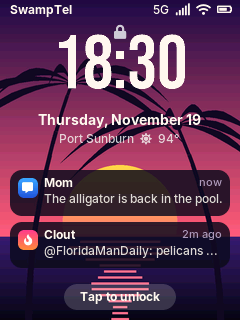<br><sub>Lock screen</sub></td><td align="center">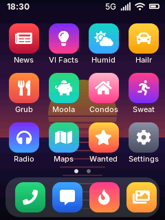<br><sub>Home</sub></td><td align="center">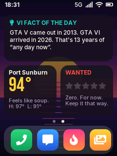<br><sub>Home, page 2 (widgets)</sub></td><td align="center">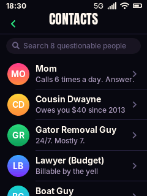<br><sub>Phone: contacts</sub></td></tr>
<tr><td align="center">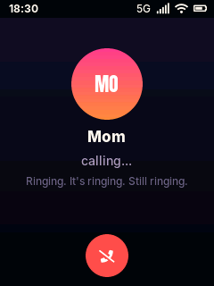<br><sub>Phone: calling Mom</sub></td><td align="center">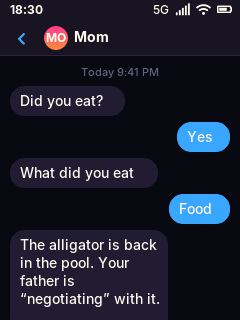<br><sub>Txtz: Mom</sub></td><td align="center">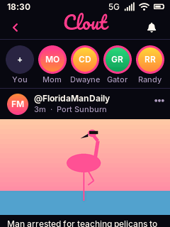<br><sub>Clout feed (video post)</sub></td><td align="center">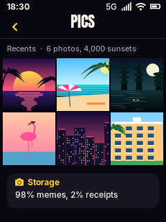<br><sub>Pics</sub></td></tr>
<tr><td align="center">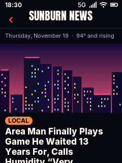<br><sub>Sunburn News</sub></td><td align="center">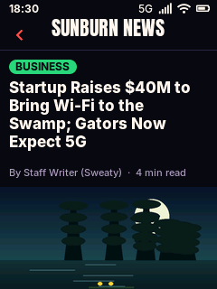<br><sub>News article</sub></td><td align="center">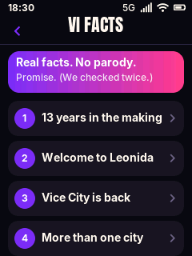<br><sub>VI Facts</sub></td><td align="center">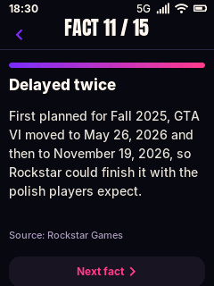<br><sub>A VI fact, with source</sub></td></tr>
<tr><td align="center">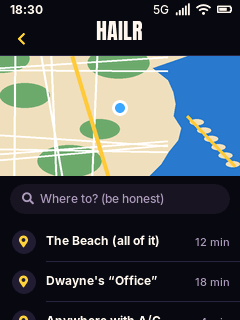<br><sub>Hailr: where to?</sub></td><td align="center">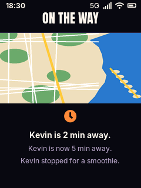<br><sub>Hailr: ride on the way</sub></td><td align="center">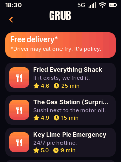<br><sub>Grub</sub></td><td align="center">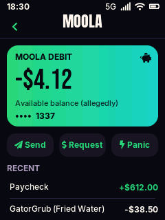<br><sub>Moola</sub></td></tr>
<tr><td align="center">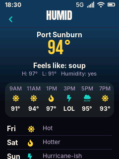<br><sub>Humid weather</sub></td><td align="center">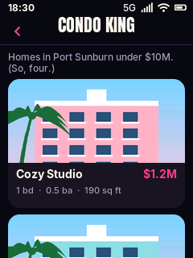<br><sub>Condo King</sub></td><td align="center">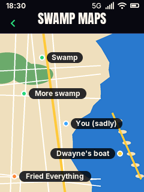<br><sub>Swamp Maps</sub></td><td align="center">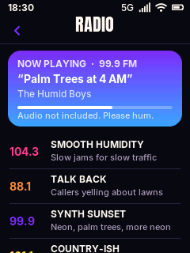<br><sub>Radio</sub></td></tr>
<tr><td align="center">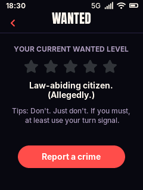<br><sub>Wanted</sub></td><td align="center">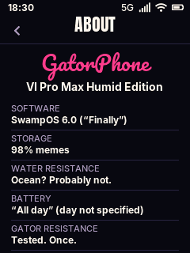<br><sub>Settings: About</sub></td></tr>
</table>

These are simulator renders of the pack. On the device the same screens are drawn by the same code (16-bit colour, so gradients band slightly). To regenerate them after changing the pack:

```bash
make -C simulator && tools/.venv/bin/python tools/make_screenshots.py   # -> docs/screenshots/
```

## 6. Development

```bash
tools/.venv/bin/python -m pytest -q tools/tests       # unit + end-to-end tests (sim, diff, packs)
tools/.venv/bin/python tools/make_test_pack.py        # synthetic test packs -> sd/packs/0000-00-00_test-*
simulator/build/sim --pack sd/packs/0000-00-00_test-a --screen alpha/main --out /tmp/a.png \
    --input "tap:120,90;wait:500"                     # scripted input, --measure-transition, --regions
tools/.venv/bin/python tools/devserial.py cmd INFO "TAP 120 285"   # device serial commands (see main.cpp)
tools/.venv/bin/python tools/devserial.py shot /tmp/panel.png      # read pixels back from the panel
```

## 7. Pins and audio (PLAN.md §9)

The pins were verified against witnessmenow/ESP32-Cheap-Yellow-Display PINS.md:

| Function | Pins |
|---|---|
| Display (HSPI) | MOSI 13, MISO 12, SCK 14, CS 15, DC 2, backlight 21 |
| Touch (bit-banged) | CLK 25, MOSI 32, MISO 39, CS 33, IRQ 36 |
| SD (VSPI) | MOSI 23, MISO 19, SCK 18, CS 5 |
| RGB LED (active low) | 4, 16, 17 |
| Light sensor | 34 |
| Speaker | 26 (reserved, unused) |

Radio is not built. `hal::AudioService` (`play`, `stop`, `set_volume`, `is_playing`) is a stub that reports success, and the schema's `station` element calls it. GPIO 26 stays free for the onboard speaker. **An external I2S audio board would need the RGB LED pins (4, 16, 17).**
